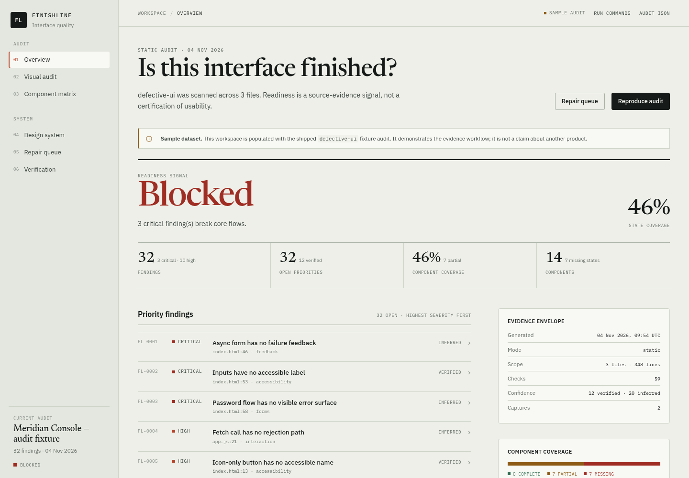
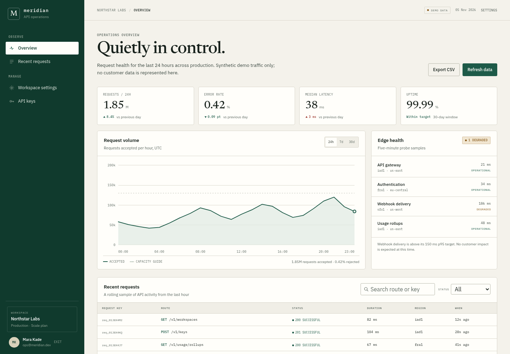
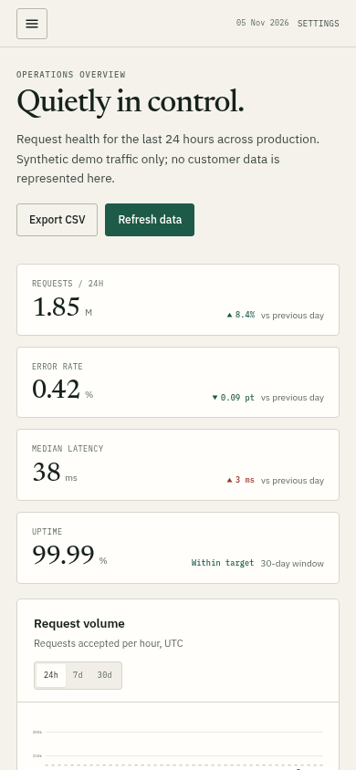

# FINISHLINE

**Don't just make it look finished. Make sure it is finished.**

[](https://github.com/Shataraimut/finishline/actions/workflows/ci.yml)
[](https://www.python.org/)
[](pyproject.toml)
[](LICENSE)
[](scripts/lib/rules.py)

FINISHLINE is an evidence-first UI/UX quality workflow for web interfaces. It gives an AI coding agent, a designer, or an engineer a repeatable way to answer a harder question than "does it look good?":

> Does this interface hold up when the data is empty, the network fails, the user only has a keyboard, the screen is 320px wide, and the action is destructive?

It combines a 59-check static audit, a component-state matrix, rendered verification, a repair loop, and a quality report that states its own limits.

## What's inside

| Artifact | Purpose |
|---|---|
| **Static engine** | Scans HTML, CSS, JS, Vue, Svelte, and Astro for accessibility, state, form, responsive, typography, precision, and anti-slop risks. |
| **Skill contract** | [`SKILL.md`](SKILL.md) teaches an agent Build, Audit, Repair, and Verify modes with explicit evidence rules. |
| **11 references** | Working guidance on states, feedback, UX writing, accessibility, responsive design, precision, visual QA, and more. |
| **Offline workspace** | A six-route quality lab that reads a real audit JSON and screenshot manifest. No backend, no build step, no network. |
| **Meridian examples** | Three complete reference pages — login, dashboard, settings — with real states, not a single polished screenshot. |
| **Templates** | Audit brief, state matrix, quality report, and a small role-based token starter. |
| **Tests** | Standard-library `unittest` coverage for the engine, regressions, CLIs, reports, schema, and both UI examples. |

## Evidence, not decoration



The workspace is an explicitly labelled **sample audit** of a deliberately defective fixture. It is not a client result and the numbers are not marketing metrics.

| Meridian — dashboard | Meridian — mobile |
|---|---|
|  |  |

The Meridian pages are complete, offline examples: demo credentials, validation, loading and failure feedback, password reveal, searchable/filterable tables, CSV export, empty states, a dirty-state save bar, token rotation, type-to-confirm deletion, reduced motion, and mobile navigation.

Demo access: `ops@meridian.dev` / `meridian-demo`.

## Quick start

No dependencies. Python 3.11+ and, for screenshots, a Chromium binary.

```bash
git clone https://github.com/Shataraimut/finishline.git
cd finishline

# Audit any project
python3 scripts/audit.py path/to/project --out audit.json

# Turn the evidence into a report
python3 scripts/report.py audit.json --format html --out report.html

# Capture real viewports (not a substitute for interaction testing)
python3 scripts/capture.py path/to/project --out screenshots \
  --viewports desktop:1440x1000,mobile:390x844

# Validate the package and an audit file
python3 scripts/validate.py --audit audit.json --strict

# Run the test suite
python3 -m unittest discover -s tests -v
```

Audit the shipped examples:

```bash
python3 scripts/audit.py examples --out /tmp/examples.json --fail-on high
```

### Use as an OpenCode skill

Copy or symlink this repository into your OpenCode skills directory:

```bash
git clone https://github.com/Shataraimut/finishline.git \
  ~/.config/opencode/skills/finishline
```

OpenCode discovers `SKILL.md` from the directory. The skill routes to references only when the task needs them.

### Run the offline workspace

```bash
python3 -m http.server 4173 --directory ui/workspace
# open http://127.0.0.1:4173
```

Routes: overview, findings, components, repairs, visual evidence, verification. Triage changes live in `localStorage`; the sample dataset never pretends to be live.

### Run the Meridian examples

```bash
python3 -m http.server 4175 --directory examples
# open http://127.0.0.1:4175/login-page/
```

## Readiness model

| Readiness | Meaning |
|---|---|
| `ready` | No critical, high, or medium **static** finding. Rendered checks still required. |
| `needs-polish` | Medium findings remain; core flows are not blocked. |
| `at-risk` | High findings remain; a primary flow or accessibility path is compromised. |
| `blocked` | Critical findings remain; data, auth, or a core task is broken. |
| `insufficient-evidence` | Nothing assessable was found. Not a pass. |

Severity is about user consequence, not code difficulty. A missing focus ring on the only checkout action is high. A single off-grid padding is low.

## What the audit checks

| Category | Checks | Examples |
|---|---:|---|
| Accessibility | 16 | viewport/zoom, language and title, alt text, labels, icon-button names, focus-visible, reduced motion, skip link, landmarks, contrast, hover-only content, input size |
| State | 10 | toggle ON, async loading, invalid inputs, empty, dialog close/Escape/focus, dropdown empty, disabled styling |
| Forms | 7 | validation, success/failure/pending feedback, secret reveal, unsaved changes, auth errors |
| Precision | 7 | fixed widths, spacing grid, radius system, z-index, `!important`, icon sizes, colour tokens |
| Typography | 5 | family count, type scale, weights, body line-height, font-display |
| Anti-slop | 5 | lorem ipsum, hype copy, generic gradients, glassmorphism, oversized radii |
| Interaction | 4 | destructive confirmation, network error, live toasts, focus-first-error |
| Responsive | 4 | breakpoints, table overflow, touch-action, hidden overflow |
| Motion | 1 | `transition: all` |

The engine is deliberately heuristic. It reads source; it cannot see rendered layout, screen-reader output, or JavaScript-composed states. Contrast checks use same-block literal pairs only. A clean run means "the static checks found nothing above threshold", not "the product is finished".

## Repository layout

```text
finishline/
├── SKILL.md                  # agent contract and workflows
├── references/               # 11 focused guides
├── templates/                # brief, matrix, report, token starter
├── scripts/
│   ├── audit.py              # static audit CLI
│   ├── capture.py            # Chromium viewport capture
│   ├── report.py             # Markdown / self-contained HTML
│   ├── validate.py           # package + schema gate
│   ├── workspace_data.py     # evidence loader
│   └── lib/                  # scanner, components, rules, schema check
├── schemas/audit.schema.json # strict audit contract
├── ui/workspace/             # offline quality lab
├── examples/                 # Meridian login, dashboard, settings
├── tests/                    # fixture + stdlib tests
├── docs/screenshots/         # real captured evidence
└── research/                 # original competitive analysis
```

## Design principles

1. **Inspect before judging.** Source, rendered page, exercised state.
2. **Every claim needs evidence.** A location, a command, a screenshot, a test.
3. **Never fabricate.** No invented metrics, screenshots, or accessibility scores.
4. **A state you did not exercise is not finished.**
5. **Static analysis is not certification.** Manual keyboard, zoom, screen-reader, and content review still apply.
6. **Fix the system, not the symptom.** One missing state model usually explains many findings.
7. **Preserve the product's real constraints.** Offline-first, stack limits, brand rules, and data contracts outrank generic taste.

## Development

```bash
python3 -m unittest discover -s tests -v
python3 scripts/validate.py --audit /tmp/fixture-audit.json --strict
```

Contributions are welcome. Read [CONTRIBUTING.md](CONTRIBUTING.md) before adding a rule: every new check needs a test, a concrete user consequence, and an honest confidence level.

## License

MIT © 2026 Shataraimut. See [LICENSE](LICENSE).

Bundled IBM Plex Sans, IBM Plex Mono, and Newsreader webfonts are distributed under the SIL Open Font License; see [`examples/shared/fonts/OFL.txt`](examples/shared/fonts/OFL.txt) and [`ui/workspace/fonts/OFL.txt`](ui/workspace/fonts/OFL.txt).
